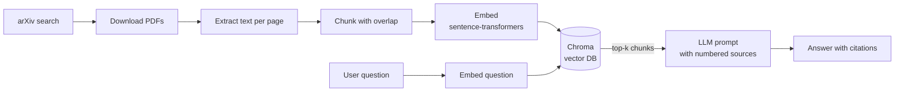

# 📚 AI Research Assistant

An LLM-powered assistant that searches arXiv, reads scientific papers, and answers questions about them **with citations to the exact paper and page**.

Built step by step to cover the full LLM engineering stack: RAG, evaluation, agents, fine-tuning and MLOps.

> **Status:** Stage 1 (RAG pipeline) ✅ · Stage 2 (evaluation) 🚧 — see the [roadmap](#roadmap).


## Demo

```bash
$ research-assistant fetch "retrieval augmented generation" --max 5
$ research-assistant ask "What are the main limitations of RAG systems?"

The main limitations are retrieval errors, where irrelevant passages are
retrieved [1][3], and the model ignoring retrieved context [2]...

Sources:
  [1] Retrieval-Augmented Generation for Large Language Models: A Survey - p.4
  ...
```

<!-- TODO: replace with a GIF of your terminal or UI -->

## How it works



| Component | Choice | Why |
|---|---|---|
| Paper source | arXiv API | Free, millions of papers |
| PDF parsing | pypdf | Simple, keeps page numbers for citations |
| Embeddings | `all-MiniLM-L6-v2` | Runs locally, free, fast |
| Vector DB | Chroma (persistent) | Zero setup, stored on disk |
| LLM | Any OpenAI-compatible API (Groq, Ollama, OpenAI) | Swap models via `.env` |

## Run it in the cloud (no local setup)

Everything runs on GitHub Actions:

1. Add your LLM API key as a repository secret named `LLM_API_KEY` (Settings → Secrets and variables → Actions).
2. Go to the **Actions** tab → **Ask the research assistant** → **Run workflow**.
3. Enter an arXiv query and a question. The answer appears in the run summary.

Every push also runs linting and tests automatically (CI workflow).

## Evaluation

Retrieval is evaluated on a fixed corpus of 5 RAG papers and 12 hand-written questions ([`eval/questions.json`](eval/questions.json)). Each question records the paper that answers it, evidence phrases and a reference answer.

- **Relevance:** a retrieved chunk is relevant when it comes from the expected paper *and* contains an evidence phrase.
- **Metrics:** Hit@1, Hit@5, MRR@10, paper-level Hit@5 and retrieval latency.
- **Experiments:** chunk sizes (500 / 1000 / 1500 characters, 20% overlap) × retrieval methods:
  - `vector`: cosine similarity on sentence-transformer embeddings
  - `hybrid`: BM25 keyword search + vector search, merged with reciprocal rank fusion
  - `hybrid+rerank`: hybrid candidates re-scored by a cross-encoder (`ms-marco-MiniLM-L-6-v2`)
- **Answer quality (optional):** answers from the best configuration are graded 0–2 against the reference by an LLM judge.

Run it from **Actions → Evaluate retrieval → Run workflow**, or locally with `research-assistant evaluate --judge`.

## Local setup

```bash
git clone https://github.com/<your-username>/llm-research-assistant.git
cd llm-research-assistant
python -m venv .venv && source .venv/bin/activate   # Windows: .venv\Scripts\activate
pip install -e ".[dev]"
cp .env.example .env    # then add your API key
```

**Free LLM options:** a [Groq](https://console.groq.com) API key (free tier), or [Ollama](https://ollama.com) to run everything locally.

## Usage

```bash
research-assistant fetch "<arxiv search query>" --max 5   # download + index papers
research-assistant ask "<your question>"                  # answer with citations
research-assistant stats                                  # index size
pytest                                                    # run tests
```

## Roadmap

- [x] **Stage 1 — RAG pipeline:** ingestion, chunking, embeddings, vector search, cited answers
- [ ] **Stage 2 — Evaluation:** test set of Q&A pairs, retrieval metrics (hit rate, MRR), answer quality with RAGAS; compare chunk sizes, hybrid search (BM25 + vectors) and reranking
- [ ] **Stage 3 — Agent:** LLM decides when to search arXiv, fetch new papers or query the index (tool calling, LangGraph)
- [ ] **Stage 4 — Fine-tuning:** LoRA fine-tune a small open model to summarise abstracts; compare quality, cost and latency vs. a large model; publish on Hugging Face
- [ ] **Stage 5 — MLOps:** FastAPI + Streamlit, Docker, GitHub Actions CI, tracing with Langfuse, deployment on AWS

## Results

<!-- Paste the tables from the "Evaluate retrieval" run summary here, e.g.
| Setup | Hit rate @5 | Faithfulness | Latency |
|---|---|---|---|
| chunk 500 | ... | ... | ... |
| chunk 1000 | ... | ... | ... |
-->

## What I learned

<!-- Write 3-5 honest bullet points per stage. Recruiters read this section. -->

## Project structure

```
src/research_assistant/
├── config.py         # settings from .env
├── arxiv_client.py   # search + download papers
├── ingest.py         # PDF -> page text -> chunks
├── vectorstore.py    # embeddings + Chroma
├── rag.py            # retrieval + prompt + LLM call
├── metrics.py        # Hit@k, MRR, rank fusion, judge parsing
├── evaluation.py     # Stage 2 experiments and report
└── cli.py            # command-line interface
eval/
└── questions.json    # fixed corpus + test questions
tests/
├── test_chunking.py
└── test_metrics.py
.github/workflows/
├── ci.yml            # lint + tests on every push
├── ask.yml           # run the assistant in the cloud
└── evaluate.yml      # run the evaluation in the cloud
```
