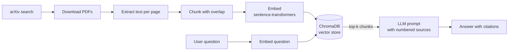
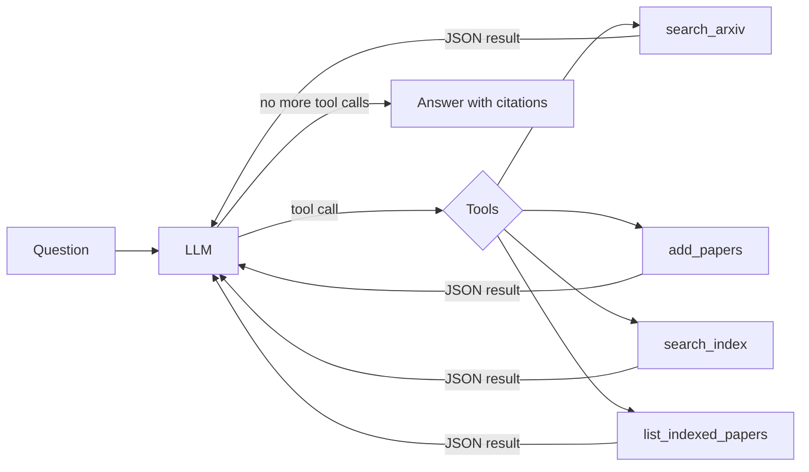

# 📚 AI Research Assistant


An LLM-powered research assistant for scientific papers. It searches arXiv, reads papers, and answers questions **with citations to the exact paper and page**, either through a fixed RAG pipeline or through an **agent that decides for itself which tools to use**.

Built step by step to cover the LLM engineering stack: RAG, evaluation, agents, fine-tuning and MLOps. Everything runs in the cloud on **GitHub Actions**, with no local setup needed.

> **Status:** Stage 1 (RAG pipeline) ✅ · Stage 2 (evaluation) ✅ · Stage 3 (agent) ✅ · Stage 4 (fine-tuning) ⏳ — see the [roadmap](#roadmap).

## Highlights

- **RAG from scratch:** PDF ingestion, chunking with overlap, local embeddings, vector search with ChromaDB, cited answers.
- **Measured, not guessed:** a fixed test set comparing 3 chunk sizes × 3 retrieval methods (vector, hybrid BM25 + vector, cross-encoder reranking), plus LLM-as-judge answer grading and failure analysis.
- **Agent with tool calling:** a plain Python tool-calling loop (no framework) with guardrails, error handling and a full trace of every decision.
- **Engineering practices:** CI with linting and tests on every push, a tested agent loop using a scripted fake LLM, secrets management, and graceful handling of external API failures.

## Demo: the agent at work

**Question:** *How does Self-RAG decide when to retrieve, and how does that differ from standard RAG?*

| Step | Tool | Result |
|---|---|---|
| 1 | `search_arxiv("Self-RAG retrieval decision when to retrieve")` | 8 results; arXiv's top result was off-topic |
| 2 | `add_papers(["2310.11511v1"])` | indexed the Self-RAG paper only (274 chunks) |
| 3 | `search_index("when to retrieve")` | 5 passages from Self-RAG |

**Answer (excerpt):** Self-RAG does not retrieve a fixed set of documents before generating. At each segment it emits a special retrieval token predicting whether external evidence would help; if so, it retrieves passages, processes them in parallel and selects the best continuation with segment-level beam search. Retrieval can be triggered by a hard rule (the token is emitted) or a soft rule (its probability exceeds a threshold) [arXiv:2310.11511v1, p.4–5]. Standard RAG instead follows a static retrieve-then-generate pipeline.

## How it works

### RAG pipeline (Stage 1)



| Component | Choice | Why |
|---|---|---|
| Paper source | arXiv API | Free, millions of papers |
| PDF parsing | pypdf | Simple, keeps page numbers for citations |
| Chunking | 500 characters, 100 overlap | Best vector-search result in the Stage 2 evaluation |
| Embeddings | `all-MiniLM-L6-v2` | Runs locally, free, fast |
| Vector store | ChromaDB (persistent) | Zero setup, stored on disk |
| LLM | Any OpenAI-compatible API (default: Groq, `openai/gpt-oss-120b`) | Swap providers and models via configuration |

### Research agent (Stage 3)



- **Tools** are described to the LLM with JSON schemas; it decides which to call, with which arguments and in what order.
- **Guardrails:** a step budget, at most 3 papers per `add_papers`, only ids returned by `search_arxiv` can be indexed, and result sizes are capped.
- **Robustness:** tool errors, including arXiv outages (HTTP 503), are returned to the LLM so it can adapt, instead of crashing the run. Rate-limited LLM calls are retried with backoff.
- **Traceability:** every tool call is logged and shown in the run summary.
- **Tested** with a scripted fake LLM: tool execution, step limit, invalid arguments and rate-limit retries.

## Evaluation (Stage 2)

Retrieval is evaluated on a fixed corpus of 5 RAG papers and 12 hand-written questions ([`eval/questions.json`](eval/questions.json)). Each question records the paper that answers it, evidence phrases and a reference answer.

- **Relevance:** a retrieved chunk is relevant when it comes from the expected paper *and* contains an evidence phrase.
- **Metrics:** Hit@1, Hit@5, MRR@10, paper-level Hit@5 and retrieval latency.
- **Methods compared:**
  - `vector`: cosine similarity on sentence-transformer embeddings
  - `hybrid`: BM25 keyword search + vector search, merged with reciprocal rank fusion
  - `hybrid+rerank`: hybrid candidates re-scored by a cross-encoder (`ms-marco-MiniLM-L-6-v2`)
- **Answer quality:** answers from the best configuration are graded 0–2 against the reference by an LLM judge.

### Retrieval results

| Chunk size | Method | Chunks | Hit@1 | Hit@5 | MRR@10 | Paper hit@5 | Latency (ms) |
|---|---|---|---|---|---|---|---|
| 500 | vector | 1044 | 0.58 | 0.75 | 0.67 | 1.00 | 10 |
| 500 | hybrid | 1044 | 0.42 | 0.75 | 0.56 | 0.92 | 13 |
| 500 | hybrid+rerank | 1044 | 0.58 | **0.92** | **0.72** | 1.00 | 500 |
| 1000 | vector | 532 | 0.25 | 0.83 | 0.53 | 1.00 | 10 |
| 1000 | hybrid | 532 | 0.42 | 0.83 | 0.59 | 0.92 | 12 |
| 1000 | hybrid+rerank | 532 | 0.50 | 0.83 | 0.67 | 1.00 | 1132 |
| 1500 | vector | 367 | 0.33 | 0.83 | 0.53 | 0.83 | 11 |
| 1500 | hybrid | 367 | 0.42 | 0.92 | 0.62 | 0.92 | 12 |
| 1500 | hybrid+rerank | 367 | 0.58 | 0.83 | 0.70 | 1.00 | 1795 |

**Findings**
- **Reranking** gives the best ranking quality at every chunk size (MRR@10 up to 0.72) but is 50–170× slower (0.5–1.8 s per query), growing with chunk size.
- **Hybrid search did not improve on pure vector search** here and slightly reduced paper-level accuracy: all papers share RAG vocabulary, so keyword matches pull in chunks from the wrong paper.
- **Chunk size trades precision for recall:** 500-character chunks rank the exact passage first more often (vector Hit@1 0.58 vs 0.25 at 1000), while larger chunks find it in the top 5 more often.
- **Best cost/quality trade-off:** vector search with 500-character chunks (MRR@10 0.67 at ~10 ms), now the default.
- **Reproducible:** repeated runs give identical retrieval metrics.
- **Limitation:** with 12 questions, each question is worth 0.08, so small differences are within noise.

### Answer quality (LLM-as-judge)

With the best retrieval configuration (500 / hybrid+rerank), answers scored **1.75 / 2** on average, with **10/12 fully correct**.

- **q02, retrieval failure:** the evidence was not retrieved, and the model correctly avoided inventing the answer (generic answer, no hallucination).
- **q10, grounding failure:** relevant evidence was retrieved, but the answer contradicted it, likely misled by a passage describing an always-retrieve baseline. The Stage 3 agent answered the same question correctly.
- **Caveat:** the same model generates and judges answers, which can inflate scores.

## Run it in the cloud (no local setup)

Everything runs on GitHub Actions:

1. Add your LLM API key as a repository secret named `LLM_API_KEY` (Settings → Secrets and variables → Actions). A free [Groq](https://console.groq.com) key works.
2. Optionally set repository variables `LLM_MODEL` and `LLM_BASE_URL` to change the model or provider.
3. Go to the **Actions** tab and run one of the workflows:

| Workflow | What it does |
|---|---|
| **Ask the research assistant** | Fetches papers for a query and answers a question (RAG pipeline) |
| **Run the research agent** | The agent finds papers and answers on its own; the trace appears in the run summary |
| **Evaluate retrieval** | Runs the Stage 2 experiments, optionally with LLM-as-judge grading |
| **CI** | Runs automatically on every push: linting (ruff) and tests (pytest) |

## Local setup

```bash
git clone https://github.com/b-k-f/llm-research-assistant.git
cd llm-research-assistant
python -m venv .venv && source .venv/bin/activate   # Windows: .venv\Scripts\activate
pip install -e ".[dev]"
cp .env.example .env    # then add your API key
```

**Free LLM options:** a [Groq](https://console.groq.com) API key (free tier), or [Ollama](https://ollama.com) to run everything locally.

## Usage

```bash
research-assistant fetch "<arxiv search query>" --max 5   # download + index papers
research-assistant ask "<your question>"                  # RAG answer with citations
research-assistant agent "<your question>"                # agent finds papers and answers
research-assistant evaluate --judge                       # Stage 2 evaluation
research-assistant stats                                  # index size
pytest                                                    # run tests
```

## Roadmap

- [x] **Stage 1 — RAG pipeline:** ingestion, chunking, embeddings, vector search, cited answers
- [x] **Stage 2 — Evaluation:** test set, retrieval metrics (Hit@k, MRR), chunk sizes × vector / hybrid / reranking, LLM-as-judge answer grading
- [x] **Stage 3 — Agent:** the LLM decides when to search arXiv, index papers or query the index (tool calling in plain Python)
- [ ] **Stage 4 — Fine-tuning:** LoRA fine-tune a small open model to summarise abstracts; compare quality, cost and latency vs. a large model; publish on Hugging Face
- [ ] **Stage 5 — MLOps:** FastAPI + Streamlit, Docker, tracing with Langfuse, deployment on AWS

## What I learned

- **Measure before optimising.** Hybrid search and reranking are popular "best practices", but on this corpus hybrid search made results slightly worse, and reranking added a 50× latency cost for a small gain.
- **Separate retrieval errors from generation errors.** The two wrong answers in the evaluation failed for different reasons and need different fixes.
- **Agents add judgment to retrieval.** The agent filtered out arXiv's off-topic results, which the fixed pipeline blindly indexed.
- **External dependencies change and fail.** A library removed a method, an LLM provider retired a model, and the arXiv API returned 503 errors. Pinning configuration, catching specific exceptions and returning errors to the agent made the system robust.
- **Silent failures are the worst kind.** Piping output into `tee` hid a crash and produced an empty answer in a "successful" run; enabling `pipefail` made failures visible.
- **Small test sets need humility.** With 12 questions, one question changes a metric by 0.08.

## Project structure

```
src/research_assistant/
├── config.py         # settings from environment variables
├── arxiv_client.py   # arXiv search + PDF download
├── ingest.py         # PDF -> page text -> chunks
├── vectorstore.py    # embeddings + ChromaDB
├── rag.py            # retrieval + prompt + LLM call
├── metrics.py        # Hit@k, MRR, rank fusion, judge parsing
├── evaluation.py     # Stage 2 experiments and report
├── tools.py          # agent tools + JSON schemas
├── agent.py          # Stage 3 tool-calling loop and trace
└── cli.py            # command-line interface
eval/
└── questions.json    # fixed corpus + test questions
tests/
├── test_chunking.py
├── test_metrics.py
└── test_agent.py
.github/workflows/
├── ci.yml            # lint + tests on every push
├── ask.yml           # RAG pipeline in the cloud
├── agent.yml         # research agent in the cloud
└── evaluate.yml      # evaluation in the cloud
```
